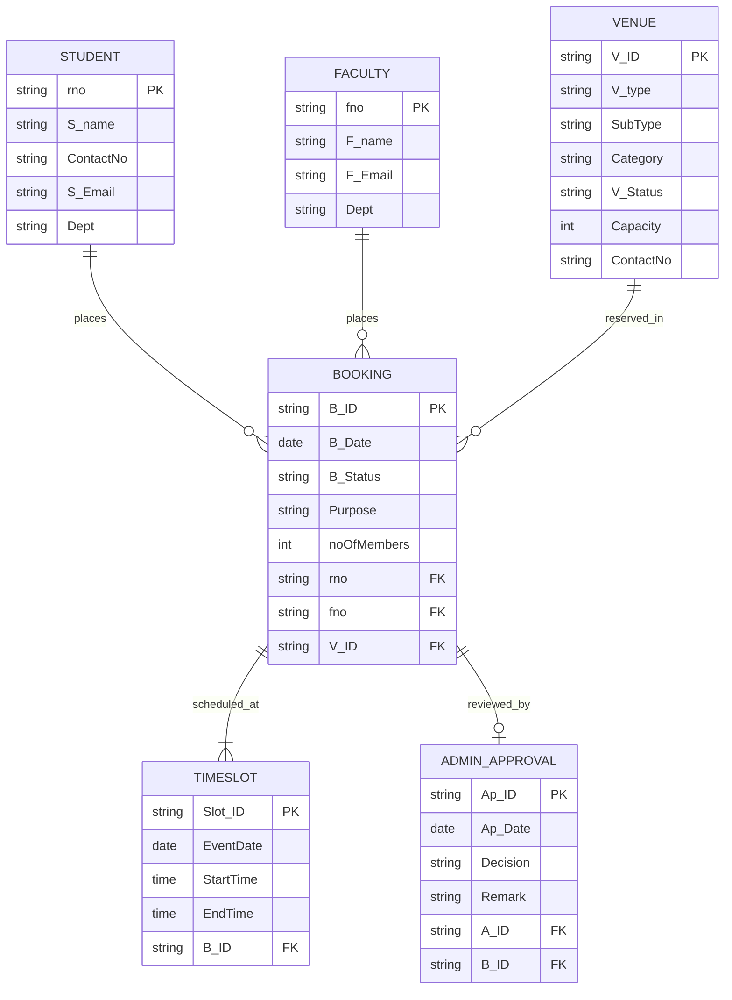

# vAccess — College Venue Booking & Approval Management System

A modern, responsive, frontend-only college venue booking and administrative approval workflow system built purely with **Vanilla HTML5, CSS3, and modern JavaScript (ES6+)**.

---

## 🏛️ Project Overview

**vAccess** simplifies how campus community members reserve college infrastructure (auditoriums, seminar halls, labs, conference rooms, sports facilities) and how administrators audit, review, approve, or reject booking requests.

### Key Highlights
- **Two Distinct Interfaces**:
  - **Student & Faculty Portal**: Browse venues, check availability, complete step-by-step booking reservations, track application status, receive automated notifications.
  - **Admin Approval Portal**: High-level administrative dashboard, filterable pending queue, comprehensive review panel with approve/reject decision modals, remark auditing, and venue status management.
- **Strict ER Model Conformance**: Data structures and relationships directly mirror the authoritative College Venue Booking ER Model (`Student`, `Faculty`, `Venue`, `Booking`, `Timeslot`, `AdminApproval`).
- **Backend-Ready Architecture**: 100% modular JavaScript design with isolated data access layers. A backend developer can transition from `localStorage` mock data to REST or GraphQL APIs simply by replacing helper functions with `fetch()` calls.
- **Zero Framework Bloat**: No React, Vue, Angular, Bootstrap, or TailwindCSS dependencies. Highly performant, accessible semantic HTML and bespoke CSS design tokens.

---

## 🚀 Getting Started

### Prerequisites
Any modern web browser (Google Chrome, Mozilla Firefox, Microsoft Edge, Safari).

### Running Locally
You can run vAccess directly by serving the project folder with any lightweight HTTP server:

#### Option 1: VS Code Live Server
Right-click `index.html` and choose **"Open with Live Server"**.

#### Option 2: Python HTTP Server
```bash
# In the project root directory:
python -m http.server 3000
```
Then navigate to: `http://localhost:3000`

#### Option 3: Node.js `npx serve`
```bash
npx serve .
```

---

## 🔑 Demo Accounts & Mock Credentials

All accounts are pre-seeded in the mock database with initial booking records and venue schedules:

| Role | Name | Email | Password | Identifier | Department |
| :--- | :--- | :--- | :--- | :--- | :--- |
| **Student** | Aarav Mehta | `aarav.mehta@college.edu` | `student123` | Roll No: `S001` | Computer Science |
| **Faculty** | Dr. Suresh Kumar | `suresh.kumar@college.edu` | `faculty123` | Faculty ID: `F001` | Computer Science |
| **Admin** | Dr. Vijay Patil | `vijay.patil@college.edu` | `admin123` | Admin ID: `A001` | Administration |

> **Tip:** You can also click the quick-fill credential chips directly on the Login page (`pages/login.html`) or register a new student/faculty account via `pages/register.html`.

---

## 📂 Project Structure

```text
vAccess/
├── index.html                   # Landing page (hero, features, quick venue preview, CTA)
├── README.md                    # Project documentation & architecture guide
├── css/
│   ├── style.css                # Global design tokens, typography, CSS variables, resets
│   ├── components.css           # UI components (buttons, badges, inputs, tables, cards, modals)
│   ├── dashboard.css            # Dashboards, timeslots, stats grid, timeline, step wizard
│   └── responsive.css           # Mobile breakpoints, tablet adaptivity, responsive navigation
├── js/
│   ├── mock-data.js             # Seed data for ER entities (Students, Faculty, Venues, etc.)
│   ├── utils.js                 # Shared helpers (date/time formatters, ID generators, toasts, dialogs)
│   ├── auth.js                  # Mock authentication, role checking, session management
│   ├── venues.js                # Venue queries, filtering, availability checks, timeslot storage
│   ├── bookings.js              # Booking CRUD, filtering, stats aggregation, requester enrichment
│   ├── notifications.js         # Automated notifications, unread counts, mark-as-read handlers
│   ├── admin.js                 # Admin approval/rejection workflows, enriched bookings, audit stats
│   └── app.js                   # Application bootstrap, sidebar init, active link highlighting
└── pages/
    ├── login.html               # Role-based login with demo helper chips
    ├── register.html            # Registration for Students and Faculty
    ├── student-dashboard.html   # Student/Faculty dashboard (stats, upcoming events, recent bookings)
    ├── venues.html              # Interactive campus venue catalog with live filters
    ├── booking.html             # 4-Step booking wizard (Venue → Slot → Details → Confirmation)
    ├── my-bookings.html         # User booking history with status filters and cancellation
    ├── booking-details.html     # Detailed booking inspection with admin feedback & lifecycle timeline
    ├── notifications.html       # User notification center with read/unread filtering
    ├── profile.html             # Profile viewer & editor mapped to student/faculty/admin entities
    ├── admin-dashboard.html     # Administrative control center with urgent pending queue
    ├── admin-bookings.html      # Administrative booking directory with CSV export & filters
    ├── admin-booking-details.html # Admin decision panel (Approve / Reject with audit remarks)
    └── admin-venues.html        # Campus venue inventory & maintenance status manager
```

---

## 🧩 ER Model Alignment

vAccess directly implements the relational concepts specified in the college ER Model:



### Entity Mapping Details
1. **`Student` (`rno`, `S_name`, `ContactNo`, `S_Email`, `Dept`)**:
   Represents student applicants. Can place bookings with roll number as foreign key.
2. **`Faculty` (`fno`, `F_name`, `F_Email`, `Dept`)**:
   Represents faculty applicants. Can place bookings with faculty number as foreign key.
3. **`Venue` (`V_ID`, `V_type`, `SubType`, `Category`, `V_Status`, `Capacity`, `ContactNo`)**:
   Campus venues with status (`Available`, `Booked`, `Maintenance`).
4. **`Booking` (`B_ID`, `B_Date`, `B_Status`, `Purpose`, `noOfMembers`, `rno`, `fno`, `V_ID`)**:
   Represents reservation requests with statuses: `Pending`, `Approved`, `Rejected`, `Cancelled`.
5. **`Timeslot` (`Slot_ID`, `EventDate`, `StartTime`, `EndTime`, `B_ID`)**:
   Time and date reservation attached to each booking.
6. **`AdminApproval` (`Ap_ID`, `Ap_Date`, `A_ID`, `Decision`, `Remark`, `B_ID`)**:
   Administrative review records containing the decision, administrator ID, and justification remarks.

---

## 🔌 Connecting to a Real Backend

Every JavaScript module in `js/` is written with clean function interfaces that isolate state interactions:

| File | Current `localStorage` Implementation | Backend Integration Target (`fetch`) |
| :--- | :--- | :--- |
| `js/venues.js` | `getVenues()` | `await fetch('/api/venues').then(r => r.json())` |
| `js/bookings.js` | `createBooking(data)` | `await fetch('/api/bookings', { method: 'POST', body: JSON.stringify(data) })` |
| `js/admin.js` | `approveBooking(id, remark)` | `await fetch('/api/bookings/' + id + '/approve', { method: 'POST', body: JSON.stringify({ remark }) })` |
| `js/admin.js` | `rejectBooking(id, remark)` | `await fetch('/api/bookings/' + id + '/reject', { method: 'POST', body: JSON.stringify({ remark }) })` |
| `js/notifications.js` | `getMyNotifications()` | `await fetch('/api/notifications').then(r => r.json())` |

---

## 🎨 Design System

- **Primary Navy / Blue Palette**:
  - Primary: `#1e3a8a` / `#2563eb`
  - Accent / Warnings: `#d97706` (Pending)
  - Success: `#16a34a` (Approved / Available)
  - Danger: `#dc2626` (Rejected / Maintenance)
- **Typography**: Inter / system UI font stack with high contrast and hierarchy.
- **Accessibility**: ARIA labels, semantic landmark elements (`<aside>`, `<header>`, `<main>`), keyboard-friendly modals.
- **Responsive**: Fully optimized for mobile screens (≤640px), tablets (≤900px), and desktop layouts.

---

## 📄 License
Academic and educational use — designed for college facility management.
